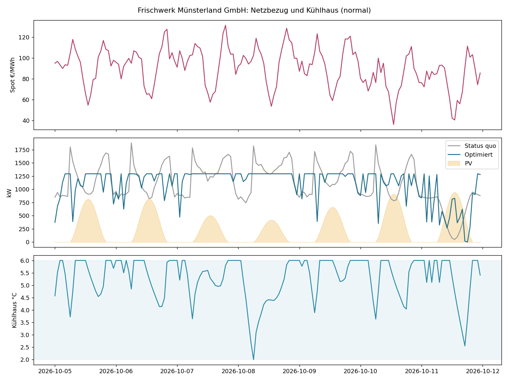

# energy-system-twin


**[Live demo](https://jonathankuhn11-spec.github.io/energy-system-twin/)**

A digital twin of a dairy with a cold store (about 11.8 GWh of electricity a year, fictional site). It
models process load, the refrigeration plant with the cold store as thermal storage, rooftop PV and an
optional battery, and optimises dispatch as a linear program. The question behind it is one a site manager
actually asks: do we need a battery, or is there cheaper flexibility already on site?

## Result

One representative week, scaled to a year (energy cost × 52, demand charge 120 €/kW·a on the weekly peak):

| Scenario | Peak load | Savings per year |
| --- | --- | --- |
| A Status quo: thermostat at 4 °C, no storage | 1,879 kW | – |
| B Pre-cooling within 2 to 6 °C | 1,355 kW | 106 k€ |
| C Pre-cooling plus 1,000 kWh battery | 1,293 kW | 125 k€ |

**The cold store is the cheaper battery.** Pre-cooling alone cuts the peak by 28 % and delivers most of the
savings. A battery adds little on top:

| Battery | Value on top of B | Capex (350 €/kWh) | Payback |
| --- | --- | --- | --- |
| 250 kWh | 5.6 k€/a | 88 k€ | 15.7 years |
| 1,000 kWh | 18.3 k€/a | 350 k€ | 19.1 years |
| 3,000 kWh | 28.2 k€/a | 1,050 k€ | 37.2 years |

The common mistake is to value the battery against the status quo instead of against pre-cooling. It
then looks like 125 k€ a year, although 106 k€ of that comes from the cold store. In a "Dunkelflaute"
scenario (price spikes above 300 €/MWh, little PV) the picture holds: 101 k€ from pre-cooling, 121 k€
with the battery.



## Does it survive real operation?

The weekly result assumes hourly steps, a one-week horizon, known parameters and known prices. None of that
holds in a plant, so each assumption is removed separately.

**Resolution and horizon.** Quarter-hourly steps (how the grid operator bills the peak), a month and a full
year with seasonal price, PV and temperature profiles all land between 104 and 112 k€. The yearly LP has
61,000 variables and HiGHS solves it in about a second.

**Parameters from measurements.** `twin/calibrate.py` estimates the five cold-store parameters from
temperature, cooling power, outside temperature and shift data. It regresses on the integrated dynamics
rather than temperature differences, because differencing divides sensor noise by the step size and biases
the capacity estimate. On a simulated week with 0.1 K and 2 % noise, four of five parameters land within
3 %, the extra heat gain is off by 9 %, and the re-simulation tracks the measured temperature to 0.11 K. If the temperature never moves (a
plain thermostat week), the capacity cannot be identified, and the function says so instead of returning
a number.

**Unknown prices.** `twin/rolling.py` runs model predictive control as it would be run in operation: every
day a 48-hour window against a price forecast, only the first day is executed, then evaluated with the
true prices.

| Variant | Forecast error (RMSE) | Savings per year |
| --- | --- | --- |
| Perfect foresight, full week | – | 106 k€ |
| MPC 48 h, persistence forecast | 10.7 €/MWh | 103 k€ |
| MPC 48 h, noisy forecast σ = 15 €/MWh | 13.9 €/MWh | 96 k€ |
| MPC 48 h, noisy forecast σ = 30 €/MWh | 27.8 €/MWh | 85 k€ |

Even a poor forecast keeps 85 of the 106 k€, because most of the value comes from the demand charge, which
depends on the peak and not on the price curve.

## Platform

`backend/` turns the model into a small service on real data, with no sign-up anywhere: day-ahead prices
from Energy-Charts (Fraunhofer ISE, CC BY 4.0), weather from Open-Meteo, a DuckDB time series store, a
daily run at 13:30 when next-day prices are published, and a FastAPI interface (`/ingest`, `/run`,
`/schedule`). Missing prices are filled by a ridge regression on calendar, lags and weather, which is only
used if it beats persistence in a walk-forward backtest. The real-price figure appears once the platform
has a few weeks of history.

```bash
docker compose up --build          # API on :8000 plus the daily scheduler
```

## Data quality

Before any calibration, a metered 15-minute load profile has to be clean. `twin/data_quality.py` takes a
three-week profile with two short gaps, a ten-hour gap and a meter transformer swap that over-reads by 25 %,
and repairs it: seasonal adjustment by weekday and time of day, change-point detection (binary
segmentation on log residuals), level correction, then gap filling. It finds the jump at the right
quarter hour with factor 1.248 (true: 1.25). The cleaned series is within 0.15 % of the truth, and every
edit is logged.

## Run it

```bash
git clone https://github.com/jonathankuhn11-spec/energy-system-twin.git && cd energy-system-twin
python -m venv .venv && source .venv/bin/activate
pip install -r requirements.txt
python run.py                       # scenarios, battery sizing, schedule, about 20 s
python run_extended.py              # resolution, calibration, uncertainty
python -m pytest -q                 # 37 tests: physics, economics, calibration, data quality, API
```

The browser demo uses dynamic programming over discretised storage states so it runs without a server.
Its numbers are close to the LP; the LP numbers are the reference.

## Limits

- Site, load profile and faults are synthetic. Only prices and weather are real.
- Constant COP and a single-node cold store: no stratification, door openings or product changes.
- The optimiser uses the 2 and 6 °C limits fully; in operation you would keep a margin.
- The price model is linear and does not see gas prices, residual load or plant outages.

## Next

1. Calibrate against real sub-metering data
2. Price forecast with residual load and gas features, plus prediction intervals
3. Minimum run times and switching losses of the chiller as a mixed-integer program
4. Intraday and balancing markets as extra revenue in the battery case

Model equations, all tables and the full platform description (German): [`docs/README.de.md`](docs/README.de.md)

MIT licensed. The customer is fictional.
